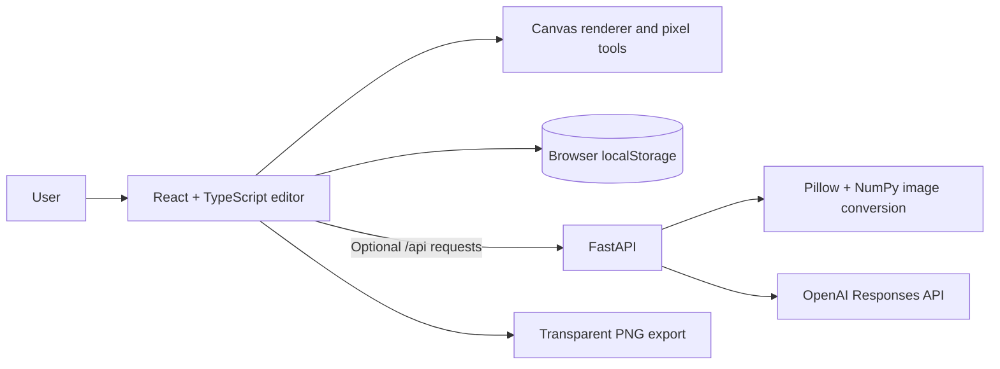

# DotMatrix Studio

DotMatrix is a lightweight pixel-art studio for drawing sprites, turning images into editable pixel grids, and exporting transparent PNGs. Artwork collections stay in the browser on the user’s device.

## What makes it different

- Edit art as pixels, crochet stitches, or round beads.
- Import images as editable grids with a browser-based fallback when the API is unavailable.
- Pick from 24 starter colors or create custom shades with a color wheel and HEX input.
- Review suggested one-pixel repairs; accept, undo, or redo each change.
- Optionally generate editable sprites from text with OpenAI.

## Tech stack

- **Frontend:** React, TypeScript, Vite, HTML Canvas
- **Backend:** FastAPI, Pillow, NumPy
- **AI:** OpenAI API, optional; requires an API key and API billing
- **Storage:** Browser `localStorage`; no account or cloud sync

## Run locally

Requirements: Node.js 18+ and Python 3.9+.

```sh
npm install
npm run dev
```

Open the URL printed by Vite, usually `http://localhost:5173`. Drawing, browser-based image import, saving, and export work without the backend.

### Optional API (image conversion and AI generation)

In a second terminal:

```sh
python3 -m venv .venv
source .venv/bin/activate
pip install -r backend/requirements.txt
export OPENAI_API_KEY="your_api_key_here"
uvicorn backend.main:app --reload --port 8000
```

Vite forwards `/api` requests to the backend. AI generation uses `gpt-6-luna` by default; set `OPENAI_MODEL` to another model available to your API account. Keep the API key on the backend and out of source control.

## System design



The browser owns editing, rendering, collection storage, and PNG export. The API optionally converts uploads or generates a structured palette and pixel grid; returned art remains editable in the browser. Image import falls back to local conversion if the API is unavailable.
