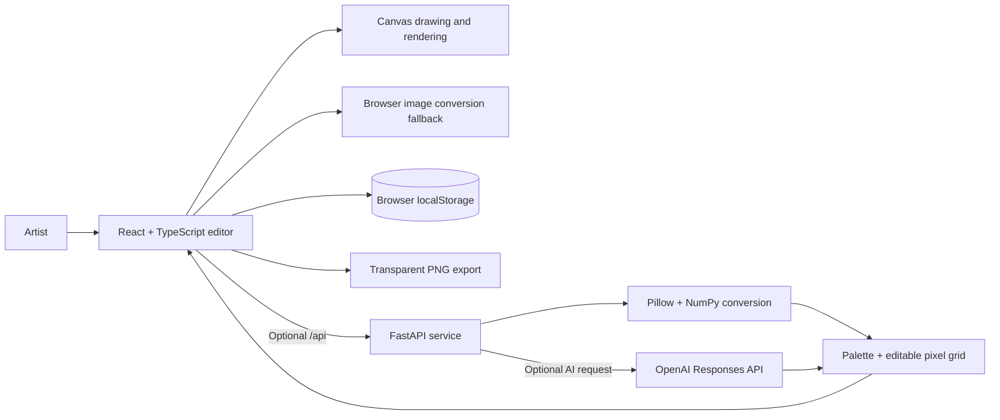

# DotMatrix Studio

**A browser-based pixel-art studio for making, editing, and collecting sprites.** Draw directly on a pixel grid, turn images into editable art, preview crochet or bead textures, and export transparent PNGs. Optional API services add server-side image conversion and AI-assisted sprite creation.

## Product highlights

- **Pixel editor:** 8, 16, 32, and 64 pixel grids with pencil, eraser, flood fill, basic shapes, zoom, undo, and redo.
- **Color control:** 24 starter swatches, an in-editor hue and shade picker, HEX input, and up to 256 palette colors.
- **Image to sprite:** Import PNG, JPG, or WEBP as editable pixels with up to 64 colors. Browser conversion works without the API; a responsive local API is also available.
- **Material previews:** Render artwork as standard pixels, crochet stitches, or round beads.
- **Sprite check:** Review heuristic suggestions for isolated pixels and small color specks. Accept or ignore suggestions; accepted edits remain undoable.
- **AI sprites (optional):** Generate a structured sprite from a text description and keep editing the returned pixels and palette.
- **Art collection:** Save, reopen, and delete work in browser storage on the current device.
- **Export:** Download transparent PNG artwork.

## Built with

| Area | Technology |
| --- | --- |
| Editor | React, TypeScript, HTML Canvas, Vite |
| API | Python, FastAPI, Uvicorn |
| Image conversion | Pillow, NumPy |
| AI sprite generation | OpenAI Python SDK, Responses API, `gpt-6-luna` by default |
| Collection storage | Browser `localStorage` |

The editor and collection run in the browser. There is no account system or cloud sync. The backend is optional; an OpenAI API key is needed only for AI sprite generation.

## Quick start

### Requirements

- Node.js 18 or newer
- Python 3.9 or newer for the optional backend

### Start the editor

```bash
npm install
npm run dev
```

Open the local address printed by Vite, usually [http://localhost:5173](http://localhost:5173). Drawing, browser-based image import, collections, and PNG export are available without starting the API.

### Start the optional API

In a second terminal from the project directory:

```bash
python3 -m venv .venv
source .venv/bin/activate
pip install -r backend/requirements.txt
uvicorn backend.main:app --reload --port 8000
```

Vite proxies `/api` requests to `http://localhost:8000`. The API supports image conversion without an OpenAI key. To enable AI sprite generation, set the key in the backend terminal before starting Uvicorn:

```bash
export OPENAI_API_KEY="your_api_key_here"
```

The configured model defaults to `gpt-6-luna`. To select another model available to your API account, set `OPENAI_MODEL` before starting the backend:

```bash
export OPENAI_MODEL="your-model-name"
```

Keep API keys out of frontend code and source control. AI usage requires an OpenAI API account with applicable billing enabled.

**Windows PowerShell:** create the environment with `python -m venv .venv`, activate it with `.venv\\Scripts\\Activate.ps1`, and use `$env:OPENAI_API_KEY="your_api_key_here"` to configure AI.

## How it works



The browser owns drawing, undo history, texture rendering, collection storage, and export. The API can convert an uploaded image or request a structured sprite from OpenAI. Both paths return a palette and pixel grid that the editor can modify. If the image API is unavailable, import falls back to browser-side conversion.

## API routes

| Route | Purpose | Requires OpenAI key? |
| --- | --- | --- |
| `GET /api/health` | Check API availability | No |
| `POST /api/convert` | Convert an uploaded image into a palette and pixel grid | No |
| `POST /api/generate` | Generate a sprite from a text prompt | Yes |

## Repository layout

```text
backend/
  main.py              FastAPI routes for health, conversion, and AI generation
  requirements.txt     Python dependencies
src/
  App.tsx              Editor state, tools, collection, import, and export
  ColorWheel.tsx       Hue and shade picker
  imageProcessing.ts   Browser image quantization fallback
  rendering.ts         Pixel, crochet, and bead renderers
  repairs.ts           Heuristic sprite inspection
  shapes.ts            Basic shape rasterization
  style.css            Application layout and visual styles
index.html             App document entry point
vite.config.ts         Frontend dev server and API proxy
```

## Data and privacy

Saved artwork is stored in the browser’s `localStorage` for that browser and device. It is not uploaded or synced. Image files sent to the optional conversion API are processed by the local backend. AI prompts are sent from the backend to OpenAI when AI generation is enabled. The OpenAI key remains in the backend environment and is not exposed to the browser.

## Production build

```bash
npm run build
npm run preview
```

The production frontend is generated in `dist/`. The FastAPI service is run separately when API functionality is needed.
