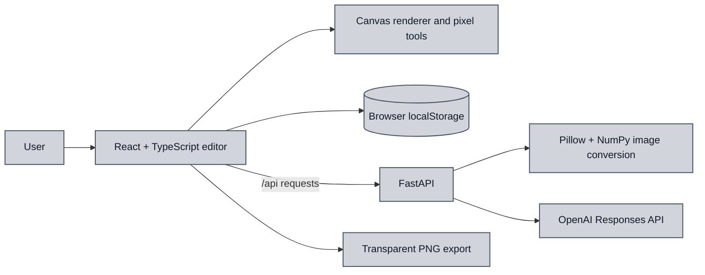

# DotMatrix Studio

DotMatrix is a pixel art studio for drawing sprites, turning images into editable pixel grids and exporting transparent PNGs. Artwork collections stay in the browser on the user’s device.

## Features

- Edit art as pixels, crochet stitches, or round beads.
- Import images as editable grids, with browser-based conversion if the API is unavailable.
- Choose from 24 starter colors or make custom shades with the color wheel and HEX input.
- Review suggested one-pixel repairs; accept, undo or redo each change.
- Generate editable sprites from text with OpenAI.

## Tech stack

- Frontend: React, TypeScript, Vite, HTML Canvas
- Backend: Python, FastAPI, Pillow, NumPy for image conversion
- OpenAI Responses API via the Python SDK, using gpt-6-luna

## System design

The browser handles drawing, rendering, collections and PNG export. The API converts images and generates structured sprite palettes and pixel grids.
